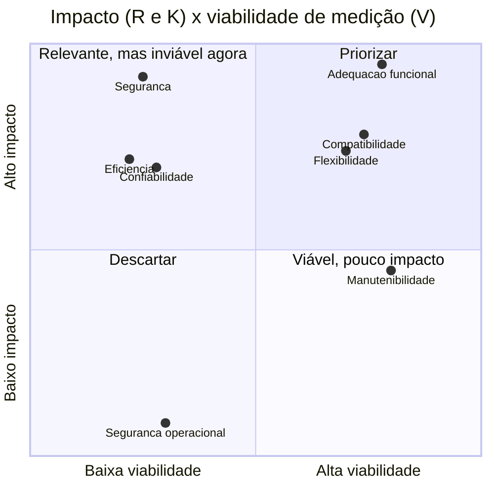

# Seleção e priorização das características

## Método

A seleção usa um método explícito em quatro passos, para que a escolha não dependa de preferência subjetiva:

1. **Universo:** as oito características da ISO/IEC 25010:2023, **exceto capacidade de interação** (usabilidade), excluída pela regra da disciplina.
2. **Notas:** cada característica recebe nota de 1 a 5 em quatro critérios, usando as âncoras da [Tabela 1](#ancoras-das-notas).
3. **Filtro de viabilidade:** só é elegível a característica com **V ≥ 3** (mensurável com os recursos da equipe) e **R ≥ 2**.
4. **Matriz ponderada e sensibilidade:** calcula-se a pontuação ponderada em três cenários de pesos; a seleção só é aceita se a ordem das elegíveis não mudar entre os cenários.

| Critério | Pergunta | Origem |
|---|---|---|
| **R** Relevância | Quanto as partes interessadas dependem desta característica? | [Partes interessadas](partes-interessadas.md) |
| **K** Risco/impacto | Qual o dano se a característica falhar na migração? | [Propósito](proposito.md) (riscos acadêmico, de integração e operacional) |
| **V** Viabilidade | Dá para medir com instalação local, dados fictícios e o prazo da disciplina? | [Implicações para a avaliação](produto.md#implicacoes-para-a-avaliacao) |
| **A** Alinhamento | Quanto o resultado apoia diretamente uma decisão D1–D3? | [Decisões apoiadas](proposito.md#decisoes-apoiadas) |

Tabela 1. Critérios de priorização. Fonte: elaboração própria.

### Âncoras das notas

| Nota | R Relevância | K Risco/impacto | V Viabilidade | A Alinhamento |
|---|---|---|---|---|
| 1 | Nenhuma parte interessada depende | Consequência desprezível | Sem recursos para medir | Nenhuma decisão apoiada |
| 2 | Dependência indireta | Incômodo localizado | Exige recursos indisponíveis (carga, especialistas) | Apoio indireto |
| 3 | Uma parte interessada depende | Compromete parte de uma tarefa | Mensurável com preparação relevante | Apoia parcialmente uma decisão |
| 4 | Várias partes dependem | Compromete tarefa importante ou exige retrabalho | Mensurável com os recursos planejados | Apoia diretamente uma decisão |
| 5 | Central para a decisora e para os usuários | Impede tarefa essencial ou corrompe resultado acadêmico | Mensurável com recursos já disponíveis e procedimento conhecido | Determina uma decisão prioritária |

Tabela 2. Âncoras para atribuir as notas. Fonte: elaboração própria.

## Pesos

O maior peso vai para a **relevância**, porque o propósito é apoiar a decisão das partes interessadas. Os cenários alternativos testam se a seleção muda quando se dá mais importância à viabilidade ou à relevância.

| Critério | Base | Viabilidade maior | Relevância maior |
|---|---:|---:|---:|
| R | 0,35 | 0,25 | 0,50 |
| K | 0,25 | 0,20 | 0,20 |
| V | 0,25 | 0,40 | 0,15 |
| A | 0,15 | 0,15 | 0,15 |
| **Soma** | **1,00** | **1,00** | **1,00** |

Tabela 3. Pesos por cenário. Fonte: elaboração própria.

Cenário Base: **P = 0,35·R + 0,25·K + 0,25·V + 0,15·A**.

## Resultado

| Característica | R | K | V | A | Base | Viab. maior | Relev. maior | Elegível |
|---|---:|---:|---:|---:|---:|---:|---:|---|
| **Adequação funcional** | 5 | 5 | 4 | 5 | **4,75** | 4,60 | 4,85 | Sim |
| **Compatibilidade** | 4 | 4 | 4 | 5 | **4,15** | 4,15 | 4,15 | Sim |
| **Flexibilidade** | 4 | 4 | 4 | 4 | **4,00** | 4,00 | 4,00 | Sim |
| Segurança | 5 | 5 | 2 | 3 | 3,95 | 3,50 | 4,25 | Não (V < 3) |
| Eficiência de desempenho | 4 | 4 | 2 | 3 | 3,35 | 3,05 | 3,55 | Não (V < 3) |
| Confiabilidade | 4 | 4 | 2 | 3 | 3,35 | 3,05 | 3,55 | Não (V < 3) |
| Manutenibilidade | 3 | 3 | 4 | 2 | 3,10 | 3,25 | 3,00 | Sim |
| Segurança operacional | 1 | 1 | 2 | 1 | 1,25 | 1,40 | 1,15 | Não |
| Capacidade de interação | — | — | — | — | — | — | — | Excluída pela regra da disciplina |

Tabela 4. Notas, pontuações e elegibilidade. Fonte: elaboração própria.

Entre as elegíveis, a ordem **adequação funcional > compatibilidade > flexibilidade > manutenibilidade** se mantém nos três cenários. São selecionadas as três primeiras.

### Justificativa das notas das selecionadas

| Característica | Justificativa das notas |
|---|---|
| Adequação funcional | **R5**: gestão acadêmica, docentes e estudantes dependem das tarefas essenciais. **K5**: uma nota calculada errado compromete o resultado acadêmico. **V4**: mensurável com dados fictícios; não recebe 5 porque o ambiente ainda não está instalado. **A5**: determina D1. |
| Compatibilidade | **R4**: integradores e administradores. **K4**: uma exportação de notas com perda obriga retrabalho manual na secretaria. **V4**: formatos e serviços web podem ser exercitados localmente. **A5**: determina D2. |
| Flexibilidade | **R4**: administradores e estudantes (acesso pelo celular). **K4**: a mudança da raiz web para `public/` (desde a 5.1) e os novos requisitos de PHP/PostgreSQL elevam o risco de falha na atualização a partir da 4.5. **V4**: instalação e atualização reproduzíveis em máquina virtual. **A4**: apoia diretamente D3. |

Tabela 5. Justificativa das notas. Fonte: elaboração própria.

### Memória de cálculo (exemplo: flexibilidade)

| Cenário | Cálculo | Resultado |
|---|---|---:|
| Base | 0,35·4 + 0,25·4 + 0,25·4 + 0,15·4 | 4,00 |
| Viabilidade maior | 0,25·4 + 0,20·4 + 0,40·4 + 0,15·4 | 4,00 |
| Relevância maior | 0,50·4 + 0,20·4 + 0,15·4 + 0,15·4 | 4,00 |

Tabela 6. Exemplo de cálculo. As 24 pontuações da Tabela 4 foram conferidas por script. Fonte: elaboração própria.

## Visão impacto × viabilidade

Figura 1. Posição das características pelo impacto (média de R e K) e pela viabilidade (V). Fonte: elaboração própria a partir da Tabela 4.

## Trade-offs discutidos

- **Segurança** teria a 2ª maior pontuação sem o filtro (3,95 no cenário Base; 4,25 no de relevância maior). Ela foi excluída porque uma avaliação séria de segurança exigiria testes de intrusão e conhecimento especializado que a equipe não tem no prazo. A decisão **depende do filtro de viabilidade** e é registrada como limitação: os resultados não dizem nada sobre a segurança do Moodle 5.3.
- **Eficiência de desempenho e confiabilidade** são relevantes para uma instituição com milhares de usuários, mas exigem ambiente de carga e observação prolongada, fora do alcance da instalação local.
- **Manutenibilidade** é elegível e viável (análise estática do código aberto), mas apoia pouco as decisões D1–D3, que são de quem **opera** o Moodle e não de quem o **desenvolve**. Foi deixada de fora para preservar a profundidade das três selecionadas.
- **Relação esperada entre as selecionadas:** ampliar a cobertura funcional com plugins tenderia a reduzir a instalabilidade e a compatibilidade. Como o escopo usa só o núcleo, essa relação não poderá ser confirmada; ela será discutida como hipótese no artigo final.
