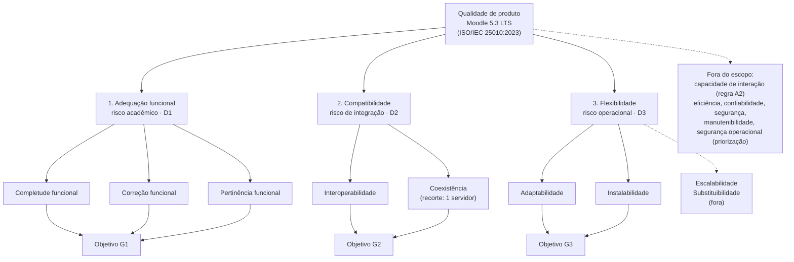

# Modelo de qualidade

## Modelo de referência

O modelo de referência é o **modelo de qualidade de produto da ISO/IEC 25010:2023**, que organiza a qualidade em nove características: adequação funcional, eficiência de desempenho, compatibilidade, capacidade de interação, confiabilidade, segurança, manutenibilidade, flexibilidade e segurança operacional (*safety*). Em relação à edição de 2011, a revisão de 2023 renomeou **portabilidade** para **flexibilidade**, incluiu a subcaracterística **escalabilidade** e renomeou **usabilidade** para **capacidade de interação** [(ISO/IEC, 2023)](../sobre/referencias.md).

A escolha da edição de 2023 é intencional: a versão-alvo do Moodle é de 2026 e a disciplina apresenta a atualização de 2023 (Aula 02-3). As medidas usadas na Fase 2 vêm da ISO/IEC 25023, que ainda usa os nomes da edição de 2011; a correspondência está indicada na [Tabela 2](#adaptacao-ao-moodle).

## Por que adaptar e não usar o modelo "de prateleira"

Usar as nove características com todas as subcaracterísticas não faria sentido para este produto e para este propósito. A adaptação foi guiada por três regras, cada uma ligada a uma fonte:

| Regra de adaptação | Origem | Efeito no modelo |
|---|---|---|
| **A1.** Manter apenas o que apoia uma decisão do requisitante (D1–D3) | [Propósito](proposito.md) | Restam as características ligadas aos riscos acadêmico, de integração e operacional |
| **A2.** Excluir capacidade de interação (usabilidade) | Regra da disciplina (Critério 5 da Fase 1) | Capacidade de interação fica fora, mesmo sendo relevante para estudantes |
| **A3.** Manter só subcaracterísticas mensuráveis em instalação local com dados fictícios | [Implicações para a avaliação](produto.md#implicacoes-para-a-avaliacao) | Escalabilidade e substituibilidade ficam fora; coexistência entra com recorte |
| **A4.** Reinterpretar cada subcaracterística no vocabulário de um LMS | Partes interessadas | Cada subcaracterística recebe uma definição operacional (Tabela 2) |

Tabela 1. Regras de adaptação do modelo. Fonte: elaboração própria.

## Adaptação ao Moodle

| Característica (25010:2023) | Subcaracterística | Interpretação no Moodle | Nome na ISO/IEC 25023 | Situação |
|---|---|---|---|---|
| Adequação funcional | Completude funcional | O núcleo oferece funções para todas as tarefas acadêmicas essenciais do catálogo | Functional completeness | Dentro |
| Adequação funcional | Correção funcional | Notas, prazos e agregações produzem o resultado esperado pelas regras configuradas | Functional correctness | Dentro |
| Adequação funcional | Pertinência funcional | As funções levam ao objetivo da tarefa sem exigir contorno (*workaround*) | Functional appropriateness | Dentro |
| Compatibilidade | Interoperabilidade | Troca de dados por arquivos (CSV, XLSX, GIFT, Moodle XML, iCal, `.mbz`) e serviços web REST, com os dados utilizáveis pelo outro lado | Interoperability | Dentro |
| Compatibilidade | Coexistência | O Moodle opera no mesmo servidor que outra aplicação web e outro banco sem prejudicá-los | Co-existence | Dentro, com recorte |
| Flexibilidade | Adaptabilidade | Os fluxos essenciais funcionam nos navegadores/dispositivos e nas versões de PHP previstas | Adaptability (portability) | Dentro |
| Flexibilidade | Instalabilidade | Instalação limpa e atualização 4.5 → 5.3 concluem com êxito, no tempo esperado e preservando dados | Installability (portability) | Dentro |
| Flexibilidade | Escalabilidade | Ajuste da capacidade a variações de carga | — | Fora (exige ambiente de carga) |
| Flexibilidade | Substituibilidade | Substituir outro LMS pelo Moodle | Replaceability | Fora (não há LMS de origem no cenário) |

Tabela 2. Subcaracterísticas mantidas e sua interpretação no Moodle. Fonte: elaboração própria a partir da ISO/IEC 25010:2023 e da ISO/IEC 25023.

## Representação gráfica

Figura 1. Modelo de qualidade adaptado, com a ordem de prioridade, a decisão apoiada e o objetivo GQM de cada característica. Linhas tracejadas: elementos fora do escopo. Fonte: elaboração própria.

A ligação entre as subcaracterísticas e os objetivos G1–G3 é detalhada na [Fase 2](../fase-2/objetivos-questoes-hipoteses.md).
