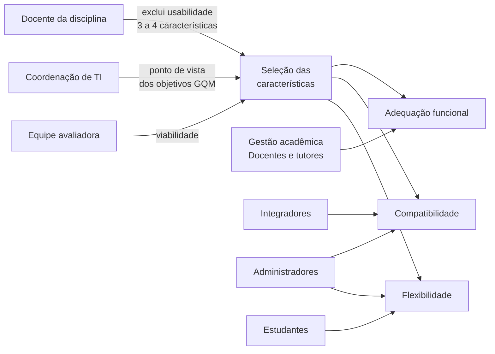

# Requisitante e partes interessadas

## Requisitante

A avaliação tem dois requisitantes, com papéis diferentes:

- **Requisitante acadêmica: a docente da disciplina.** Define as regras da atividade (por exemplo, a exclusão da usabilidade), os prazos e os critérios de avaliação do trabalho. Ela recebe o relatório.
- **Requisitante no cenário: a Coordenação de TI da instituição.** É o papel de *comprador/operador* da Aula 07. Toma as decisões D1 a D3 do [Propósito](proposito.md) e é o **ponto de vista** dos objetivos GQM da [Fase 2](../fase-2/objetivos-questoes-hipoteses.md).

## Mapa das partes interessadas

As necessidades abaixo foram derivadas da documentação oficial do Moodle, das regras da disciplina e da experiência dos integrantes como usuários do Moodle na universidade. **Não foram feitas entrevistas nesta fase**; as necessidades dos grupos marcados com (H) são hipóteses que podem ser validadas na Fase 3.

| Parte interessada | Papel (Aula 07) | Necessidade | Critério de sucesso para essa parte | Influência na avaliação |
|---|---|---|---|---|
| Docente da disciplina | Requisitante acadêmica | Avaliação rastreável, reprodutível e coerente com a especificação | Todas as métricas com fonte de dados e procedimento definidos | Exclui usabilidade; limita a 3–4 características; exige GQM e PSM |
| Coordenação de TI | Comprador e operador (decisora) | Reduzir o risco da migração para a 5.3 LTS | Ter um julgamento por característica que permita decidir D1–D3 | Define o ponto de vista dos objetivos G1–G3 |
| Gestão acadêmica (H) | Usuária indireta | Garantir que o semestre não seja prejudicado pela troca de versão | 100% das tarefas essenciais cobertas e corretas | Prioriza **adequação funcional** e define o catálogo de tarefas |
| Administradores de sistemas (H) | Operadores | Instalar e atualizar com procedimento previsível e sem perda de dados | Instalação e atualização sem erro bloqueante e com dados preservados | Prioriza **instalabilidade** e **coexistência** |
| Integradores e equipe de sistemas acadêmicos (H) | Desenvolvedores de sistemas vizinhos | Importar usuários, exportar notas e consumir serviços web sem retrabalho | Formatos e serviços testados sem perda de dados | Prioriza **interoperabilidade** |
| Docentes e tutores (H) | Usuários finais | Criar atividades, corrigir e publicar notas corretas | Notas e prazos calculados conforme configurado | Define os casos de teste de **correção funcional** |
| Estudantes (H) | Usuários finais | Acessar conteúdo, entregar atividades e ver notas, inclusive pelo celular | Tarefas concluídas nos navegadores e dispositivos usados | Define os ambientes de **adaptabilidade** |
| Comunidade Moodle (Moodle HQ e contribuidores) | Fornecedora e desenvolvedora | Receber relatos reproduzíveis de defeitos | Relatos com passos, versão e ambiente | Fornece documentação e requisitos de referência |
| Grupo Marlyn Wescoff | Equipe avaliadora | Executar a avaliação no prazo e com os recursos disponíveis | Cumprir as entregas E1 e E2 | Limita o escopo à instalação local e ao núcleo |

Tabela 1. Partes interessadas, necessidades, critérios de sucesso e influência. (H) = necessidade hipotética, ainda não validada. Fonte: elaboração própria.

## Como as partes interessadas influenciam as escolhas

Figura 1. Influência das partes interessadas sobre a seleção das características. Fonte: elaboração própria.

A [matriz de priorização](caracteristicas.md) usa o critério **R (relevância para as partes interessadas)** com o maior peso, de modo que essa influência é explícita no cálculo.
