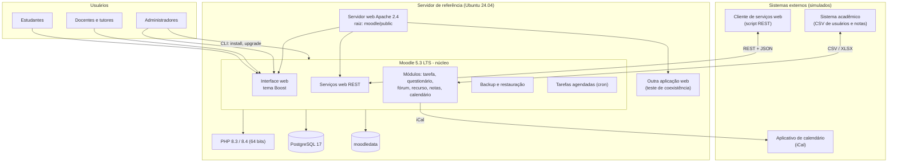

# Produto avaliado

## Identificação

| Item | Valor |
|---|---|
| Nome | Moodle LMS |
| Versão-alvo | 5.3 LTS (lançada em 05/10/2026); a versão corretiva exata (5.3.x) e o *build* serão registrados na Fase 3 |
| Versão de origem para o teste de atualização | 4.5 LTS (última versão corretiva disponível) |
| Fornecedor | Moodle HQ e comunidade Moodle |
| Licença | GNU GPL v3 ou posterior |
| Domínio de aplicação | Educação: gestão da aprendizagem em cursos presenciais, híbridos e a distância |
| Código-fonte | [github.com/moodle/moodle](https://github.com/moodle/moodle) |
| Documentação | [docs.moodle.org/503](https://docs.moodle.org/503/en/Main_page) e [moodledev.io](https://moodledev.io/general/releases/5.3) |

Tabela 1. Identificação do produto. Fonte: elaboração própria a partir de Moodle (2026).

## Tipo de produto

| Classificação | Enquadramento do Moodle | Implicação para a avaliação |
|---|---|---|
| Pressman | Aplicação web (WebApp) de sistema de informação | Acesso por navegador; o comportamento depende do servidor e do cliente, o que motiva avaliar **adaptabilidade** |
| IEEE 1062 | **COTS** (*Commercial Off-The-Shelf*): o mesmo produto é distribuído para todas as instituições; ao receber plugins e customizações locais, uma instalação pode se tornar **MOTS** | A avaliação usa **apenas o núcleo** (COTS), para que o resultado não dependa de customizações de uma instituição |
| Arquitetura | Cliente-servidor, monolito modular em PHP, extensível por plugins | Cada subsistema é avaliado pelo seu comportamento externo (caixa-preta) |
| Modelo de negócio | Código aberto, gratuito, com parceiros que vendem hospedagem e suporte | Documentação pública permite derivar requisitos de referência |

Tabela 2. Classificação do tipo de produto (Aula 07). Fonte: elaboração própria.

## Descrição estruturada

### Módulos (subsistemas) relevantes

| Módulo | Componente no código | Função | Usado em |
|---|---|---|---|
| Cursos e matrículas | `course`, `enrol` | Criar cursos, matricular usuários com papéis (estudante, professor) | G1 |
| Usuários e autenticação | `user`, `auth`, `admin/tool/uploaduser` | Cadastro manual e em lote (CSV), autenticação local | G1, G2 |
| Tarefa | `mod_assign` | Envio de arquivos/texto pelo estudante, prazos, correção e feedback | G1 |
| Questionário e banco de questões | `mod_quiz`, `question` | Questionários com correção automática; importação/exportação GIFT e Moodle XML | G1, G2 |
| Fórum | `mod_forum` | Discussões assíncronas | G1 |
| Recurso (arquivo) | `mod_resource` | Disponibilizar material | G1 |
| Livro de notas | `grade` | Agregação de notas, relatórios, exportação (CSV, XLSX, ODS) | G1, G2 |
| Calendário | `calendar` | Prazos das atividades; exportação iCal | G1, G2 |
| Backup e restauração | `backup` | Cópia de cursos em arquivo `.mbz` | G2, G3 |
| Serviços web | `webservice`, protocolo REST | API para sistemas externos | G2 |
| Instalação e atualização | `admin/cli/install.php`, `admin/cli/upgrade.php` | Instalar e atualizar pela linha de comando ou pelo navegador | G3 |
| Tarefas agendadas | `admin/cli/cron.php`, Task API | Processamento periódico (notificações, limpeza, relatórios) | G2, G3 |

Tabela 3. Módulos do Moodle relevantes para a avaliação e objetivo GQM que os utiliza. Fonte: elaboração própria a partir de Moodle (2026) e Hunt (2012).

### Interfaces

| Interface | Tipo | Quem usa |
|---|---|---|
| Interface web (tema Boost) | Usuário–sistema, HTTP(S) | Estudantes, docentes, administradores |
| API REST de serviços web | Sistema–sistema, HTTP + JSON | Sistemas acadêmicos, aplicativo móvel |
| Arquivos de importação/exportação (CSV, XLSX, ODS, GIFT, Moodle XML, iCal, `.mbz`) | Sistema–sistema, arquivo | Secretaria, integradores, docentes |
| Linha de comando (CLI) | Operador–sistema | Administradores |
| Banco de dados e `moodledata` | Sistema–infraestrutura | Moodle (acesso interno) |

Tabela 4. Interfaces do produto. Fonte: elaboração própria.

### Diagrama de contexto e arquitetura

Figura 1. Contexto e arquitetura simplificada da instalação de referência. Fonte: elaboração própria a partir de Moodle (2026).

### Dependências e restrições

| Dependência | Requisito oficial do Moodle 5.3 | Configuração de referência proposta |
|---|---|---|
| PHP | Mínimo 8.3.0, 64 bits; 8.4 suportado; extensão `sodium`; `max_input_vars` ≥ 5000 | PHP 8.3 (e 8.4 no teste de adaptabilidade de servidor) |
| Banco de dados | PostgreSQL ≥ 17; MariaDB ≥ 11.4; MySQL ≥ 8.4; SQL Server ≥ 2019 | PostgreSQL 17 |
| Servidor web | Raiz web apontando para a pasta `public/` (mudança introduzida na 5.1) | Apache 2.4 |
| Atualização | A partir do Moodle 4.4 ou posterior | Cópia de teste em 4.5 LTS |
| Navegador | Qualquer navegador compatível com padrões; testados Chrome, Firefox, Safari, Edge, MobileSafari e Chrome Android | Ver [Escopo](escopo.md) |
| Sistema operacional do servidor | Não restrito pela documentação | Ubuntu Server 24.04 LTS em máquina virtual ou contêiner |

Tabela 5. Dependências do Moodle 5.3 LTS e configuração de referência. Fonte: Moodle (2026); configuração proposta pela equipe.

{ width="760" loading="lazy" }

Figura 2. Evidência dos requisitos do Moodle 5.3 LTS usados na Tabela 5. Fonte: Moodle (2026), página <a href="https://moodledev.io/general/releases/5.3">moodledev.io/general/releases/5.3</a>, capturada em 25/10/2026.

A configuração de referência é uma **proposta** e será confirmada na Fase 3, com o registro das versões efetivamente instaladas. Os dados usados serão fictícios (usuários, cursos e notas gerados para o teste).

## Implicações para a avaliação

| É possível medir agora, com a instalação local | Não é possível medir nesta avaliação |
|---|---|
| Cobertura e correção das tarefas essenciais do núcleo | Comportamento com milhares de usuários simultâneos |
| Troca de dados por arquivos e serviços web selecionados | Integração com os sistemas reais de uma instituição |
| Coexistência com outra aplicação no mesmo servidor | Compatibilidade com o catálogo de plugins de terceiros |
| Instalação limpa e atualização 4.5 → 5.3 com dados fictícios | Uso contínuo ao longo de um semestre letivo |
| Execução dos fluxos em navegadores e dispositivos selecionados | Conformidade legal (LGPD) ou auditoria de segurança |

Tabela 6. O que dá e o que não dá para medir com os recursos da equipe. Fonte: elaboração própria.

Essas limitações explicam por que eficiência de desempenho, confiabilidade e segurança não foram priorizadas (ver [Seleção e priorização](caracteristicas.md)).
