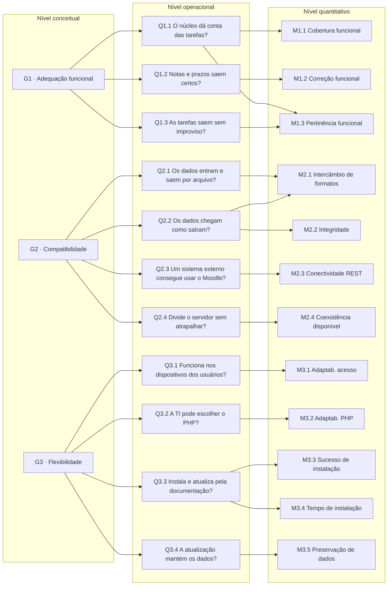

# Diagrama GQM

O diagrama mostra a hierarquia completa do plano GQM nos três níveis da Aula 08: **conceitual** (objetivos), **operacional** (questões) e **quantitativo** (métricas). A definição desce do objetivo para as métricas; a interpretação, na Fase 4, sobe das métricas para o objetivo.

## Explorador interativo

Selecione um objetivo para ver suas questões, hipóteses e métricas.

## Hierarquia completa

Figura 1. Diagrama GQM com os três objetivos, 11 questões e 12 métricas, com 14 ligações entre questões e métricas, organizados pelos níveis conceitual, operacional e quantitativo. Fonte: elaboração própria.

## Leitura do diagrama

- Cada objetivo corresponde a uma característica priorizada na Fase 1 e a uma decisão (G1 → D1, G2 → D2, G3 → D3).
- As questões perguntam sobre o objeto, e as métricas refinam cada questão (Aula 08). Três questões precisam de duas métricas: Q1.1 (M1.1, há função, e M1.3, serve sem contorno), Q2.2 (M2.1, o arquivo chegou, e M2.2, chegou igual) e Q3.3 (M3.3, sucesso, e M3.4, tempo).
- Duas métricas servem a duas questões: M1.3 a Q1.1 e Q1.3; M2.1 a Q2.1 e Q2.2. A nota de uma questão é o mínimo das notas das suas métricas ([Níveis e julgamento](niveis-e-julgamento.md#da-metrica-para-a-questao)).
- Não há métrica "solta": a [Rastreabilidade](rastreabilidade.md) confere a ligação de cada métrica até a necessidade da parte interessada.
