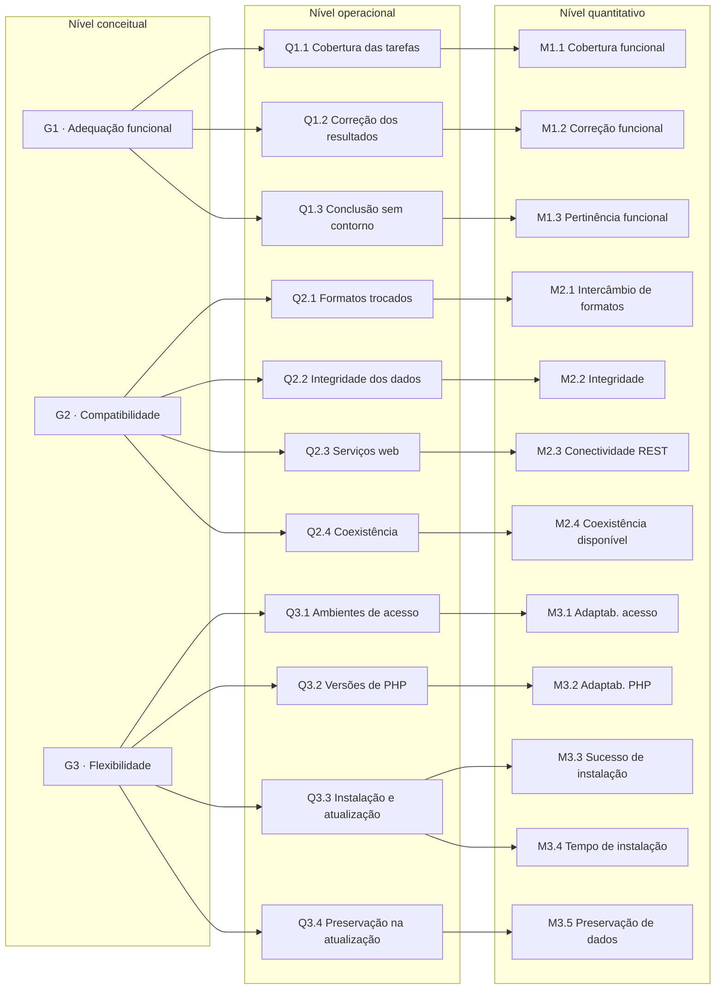

# Diagrama GQM

O diagrama mostra a hierarquia completa do plano GQM nos três níveis da Aula 08: **conceitual** (objetivos), **operacional** (questões) e **quantitativo** (métricas). A definição desce do objetivo para as métricas; a interpretação, na Fase 4, sobe das métricas para o objetivo.

## Explorador interativo

Selecione um objetivo para ver suas questões, hipóteses e métricas.

## Hierarquia completa

Figura 1. Diagrama GQM com os três objetivos, 11 questões e 12 métricas, organizados pelos níveis conceitual, operacional e quantitativo. Fonte: elaboração própria.

## Leitura do diagrama

- Cada objetivo corresponde a uma característica priorizada na Fase 1 e a uma decisão (G1 → D1, G2 → D2, G3 → D3).
- Toda métrica responde a exatamente uma questão; Q3.3 é respondida por duas métricas complementares (sucesso e tempo).
- Não há métrica "solta": a [Rastreabilidade](rastreabilidade.md) confere a ligação de cada métrica até a necessidade da parte interessada.
