# Árvore GQM de resultados

<!-- Página gerada por scripts/gera_arvore_resultados.py a partir de dados/avaliacao/calculos.csv. Não editar à mão. -->

Na Fase 2 o GQM foi definido de cima para baixo: objetivo, questões e métricas ([Diagrama GQM](../fase-2/diagrama-gqm.md)). Na Fase 4 ele é **interpretado de baixo para cima**: cada métrica medida recebe uma nota pelos [níveis de pontuação](../fase-2/niveis-e-julgamento.md), a nota da questão é o mínimo das notas das suas métricas e o objetivo é julgado pelo pior caso entre as questões.

!!! info "Situação da coleta: 2 de 12 métricas"
    Gerada a partir de `dados/avaliacao/calculos.csv`. Métricas ainda sem medidas aparecem em cinza, como *pendente*, e o objetivo correspondente fica *incompleto*.

## Árvore

```mermaid
flowchart BT
    G1["<b>G1 · Adequação funcional</b><br/>incompleto"]:::pend
    Q11["<b>Q1.1</b> Cobertura das tarefas<br/>pendente"]:::pend
    Q11 --> G1
    Q12["<b>Q1.2</b> Correção dos resultados<br/>pendente"]:::pend
    Q12 --> G1
    Q13["<b>Q1.3</b> Conclusão sem contorno<br/>pendente"]:::pend
    Q13 --> G1
    G2["<b>G2 · Compatibilidade</b><br/>incompleto"]:::pend
    Q21["<b>Q2.1</b> Formatos trocados<br/>pendente"]:::pend
    Q21 --> G2
    Q22["<b>Q2.2</b> Integridade dos dados<br/>pendente"]:::pend
    Q22 --> G2
    Q23["<b>Q2.3</b> Serviços web<br/>nota 4"]:::n4
    Q23 --> G2
    Q24["<b>Q2.4</b> Coexistência<br/>nota 2"]:::n2
    Q24 --> G2
    G3["<b>G3 · Flexibilidade</b><br/>incompleto"]:::pend
    Q31["<b>Q3.1</b> Ambientes de acesso<br/>pendente"]:::pend
    Q31 --> G3
    Q32["<b>Q3.2</b> Versões de PHP<br/>pendente"]:::pend
    Q32 --> G3
    Q33["<b>Q3.3</b> Instalação e atualização<br/>pendente"]:::pend
    Q33 --> G3
    Q34["<b>Q3.4</b> Preservação na atualização<br/>pendente"]:::pend
    Q34 --> G3
    M11["<b>M1.1</b> Cobertura funcional<br/>pendente"]:::pend
    M12["<b>M1.2</b> Correção funcional<br/>pendente"]:::pend
    M13["<b>M1.3</b> Pertinência funcional<br/>pendente"]:::pend
    M21["<b>M2.1</b> Intercâmbio de formatos<br/>pendente"]:::pend
    M22["<b>M2.2</b> Integridade<br/>pendente"]:::pend
    M23["<b>M2.3</b> Conectividade REST<br/>1,00 · nota 4<br/>H2.3 confirmada"]:::n4
    M24["<b>M2.4</b> Coexistência disponível<br/>0,67 · nota 2<br/>H2.4 refutada"]:::n2
    M31["<b>M3.1</b> Adaptab. acesso<br/>pendente"]:::pend
    M32["<b>M3.2</b> Adaptab. PHP<br/>pendente"]:::pend
    M33["<b>M3.3</b> Sucesso de instalação<br/>pendente"]:::pend
    M34["<b>M3.4</b> Tempo de instalação<br/>pendente"]:::pend
    M35["<b>M3.5</b> Preservação de dados<br/>pendente"]:::pend
    M11 --> Q11
    M12 --> Q12
    M13 --> Q13
    M21 --> Q21
    M22 --> Q22
    M23 --> Q23
    M24 --> Q24
    M31 --> Q31
    M32 --> Q32
    M33 --> Q33
    M34 --> Q33
    M35 --> Q34
    classDef n4 fill:#c8e6c9,stroke:#2e7d32,color:#1b1b1b
    classDef n3 fill:#e6f4d7,stroke:#558b2f,color:#1b1b1b
    classDef n2 fill:#ffe0b2,stroke:#ef6c00,color:#1b1b1b
    classDef n1 fill:#ffcdd2,stroke:#c62828,color:#1b1b1b
    classDef pend fill:#eeeeee,stroke:#9e9e9e,color:#555555,stroke-dasharray:4 3
```

Figura 1. Árvore GQM de resultados, das métricas (embaixo) aos objetivos (em cima). Verde: nota 4 ou 3; laranja: nota 2; vermelho: nota 1; cinza tracejado: pendente. Fonte: elaborado pelos autores a partir de <code>dados/avaliacao/calculos.csv</code>.

## Por objetivo

### G1 – Adequação funcional

**Julgamento: incompleto.** Decisão D1: Aguardar as métricas pendentes.

| Questão | Métricas (valor · nota) | Nota da questão | Hipóteses |
|---|---|---|---|
| **Q1.1** Cobertura das tarefas | M1.1 pendente | pendente | H1.1: pendente |
| **Q1.2** Correção dos resultados | M1.2 pendente | pendente | H1.2: pendente |
| **Q1.3** Conclusão sem contorno | M1.3 pendente | pendente | H1.3: pendente |

Tabela 1. Notas das questões de G1: mínimo das notas das métricas. Fonte: elaborado pelos autores a partir de <code>dados/avaliacao/calculos.csv</code>.

### G2 – Compatibilidade

**Julgamento: incompleto.** Decisão D2: Aguardar as métricas pendentes.

| Questão | Métricas (valor · nota) | Nota da questão | Hipóteses |
|---|---|---|---|
| **Q2.1** Formatos trocados | M2.1 pendente | pendente | H2.1: pendente |
| **Q2.2** Integridade dos dados | M2.2 pendente | pendente | H2.2: pendente |
| **Q2.3** Serviços web | M2.3 1,00 · 4 | 4 (Excelente) | H2.3: confirmada |
| **Q2.4** Coexistência | M2.4 0,67 · 2 | 2 (Insuficiente) | H2.4: refutada |

Tabela 2. Notas das questões de G2: mínimo das notas das métricas. Fonte: elaborado pelos autores a partir de <code>dados/avaliacao/calculos.csv</code>.

### G3 – Flexibilidade

**Julgamento: incompleto.** Decisão D3: Aguardar as métricas pendentes.

| Questão | Métricas (valor · nota) | Nota da questão | Hipóteses |
|---|---|---|---|
| **Q3.1** Ambientes de acesso | M3.1 pendente | pendente | H3.1: pendente |
| **Q3.2** Versões de PHP | M3.2 pendente | pendente | H3.2: pendente |
| **Q3.3** Instalação e atualização | M3.3 pendente M3.4 pendente | pendente | H3.3: pendente |
| **Q3.4** Preservação na atualização | M3.5 pendente | pendente | H3.4: pendente |

Tabela 3. Notas das questões de G3: mínimo das notas das métricas. Fonte: elaborado pelos autores a partir de <code>dados/avaliacao/calculos.csv</code>.

As evidências de cada métrica estão em `dados/avaliacao/<métrica>/` no repositório, e as hipóteses refutadas são explicadas pelas [medidas de contexto](../fase-2/abstraction-sheets.md) de cada coleta.
