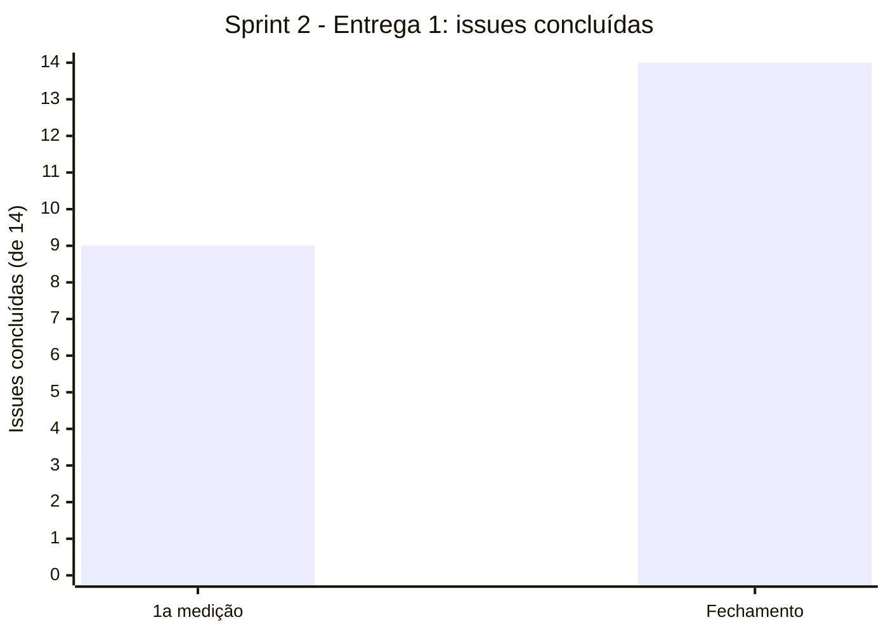

# Registro de medições

Cada medição é um retrato datado gerado por `scripts/psm_coleta.py` e guardado em `dados/gestao/`. Para cada retrato, a equipe registra a **interpretação** (comparação com os critérios do [Plano de medição](plano-psm.md)) e a **decisão de gestão** tomada.

## Como gerar uma medição

```bash
python3 scripts/psm_coleta.py --repo FCTE-Qualidade-de-Software-1/2026-2_T01_MARLYN_WESCOFF
```

O script imprime o resumo em Markdown e grava `dados/gestao/psm-AAAA-MM-DD.csv`. O workflow `psm-coleta.yml` também roda o script toda segunda-feira e versiona o retrato automaticamente.

## Medições

| Data | Sprint | Planejado vs. concluído | Esforço (R/E) | Custo realizado | Tempo de ciclo (mediana) | Issues paradas | Dados |
|---|---|---|---|---|---|---|---|
| 26/10/2026 | Sprint 2 – Entrega 1 | 9 de 14 (64%) | não calculado: 20,5 h estimadas; horas reais não registradas | não calculado | 0,5 dia | nenhuma | [`psm-2026-10-26-1.csv`](https://github.com/FCTE-Qualidade-de-Software-1/2026-2_T01_MARLYN_WESCOFF/blob/main/dados/gestao/psm-2026-10-26-1.csv) |
| 26/10/2026 (fechamento) | Sprint 2 – Entrega 1 | 14 de 14 (100%) | não calculado (horas reais não registradas) | não calculado | 0,5 dia | nenhuma | [`psm-2026-10-26-2.csv`](https://github.com/FCTE-Qualidade-de-Software-1/2026-2_T01_MARLYN_WESCOFF/blob/main/dados/gestao/psm-2026-10-26-2.csv) |

<p class="legenda">Tabela 1. Registro das medições do PSM/CID. Fonte: issues e milestones do GitHub e `dados/gestao/horas.csv`, em 26/10/2026.</p>

## Indicador: planejado vs. concluído



<p class="legenda">Figura 1. Issues concluídas da Sprint 2 (14 planejadas) na primeira medição e no fechamento, em 26/10/2026. Fonte: `dados/gestao/psm-2026-10-26-1.csv` e `psm-2026-10-26-2.csv`.</p>

## Interpretação e decisões

### Medição de 26/10/2026 (fim da Sprint 2)

**Calendário e Progresso.** As 9 issues de revisão das Fases 1 e 2, do artigo e da GitPage foram concluídas. As 5 abertas (#9 a #12 e #14) são de registro e fechamento: contribuição, declaração de IA, horas, atas e release. A diferença entre planejado e concluído (36%) passa o critério de 10% do fim da sprint. A causa é que as tarefas de registro ficaram para o fim, depois das revisões, e não atraso no conteúdo da avaliação.

- **Decisão:** concluir as issues de registro antes da release E1. A partir da E2, abrir essas tarefas no início da sprint e não no fim.
- **Acompanhamento:** as 5 issues de registro foram concluídas em 26/10/2026, antes da criação da release E1; ao fim da sprint, 14 de 14 issues estavam fechadas (segunda medição, gerada pelo workflow `psm-coleta.yml`).

**Recursos e Custos.** O esforço estimado das issues da sprint soma 20,5 h, mas os integrantes não lançaram as horas reais em `dados/gestao/horas.csv`, então a razão R/E e o custo não puderam ser calculados. Para a tabela de contribuição, a equipe registrou que o esforço da E1 foi dividido igualmente (20% por integrante).

- **Decisão:** na E2, cada integrante registra as horas ao fechar cada issue (campo do modelo de issue e `horas.csv`). A medição de R/E passa a ser feita na metade e no fim de cada sprint.

**Desempenho dos Processos.** A mediana do tempo de ciclo foi de 0,5 dia e não houve issue parada por mais de 3 dias. O valor baixo reflete que as issues de revisão foram abertas e fechadas na reta final da entrega. Por isso, ele não representa o tempo real gasto nas tarefas.

- **Decisão:** na E2, abrir as issues no planejamento da sprint, para que o tempo de ciclo meça a duração real do trabalho.
