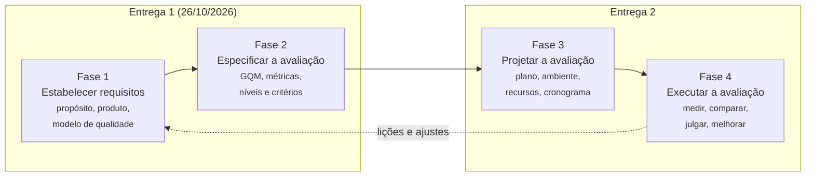

# Metodologia

Esta página descreve **como** o projeto é conduzido: o processo de avaliação seguido, a forma de organização da equipe, as ferramentas e o fluxo de trabalho no repositório. O conteúdo de cada fase está nas páginas da [Fase 1](fase-1/index.md) e da [Fase 2](fase-2/index.md).

## Processo de avaliação

O trabalho segue as quatro fases do processo de avaliação de produto da série SQuaRE (ISO/IEC 25040), conforme apresentado na Aula 07 da disciplina. A Figura 1 mostra as fases, os produtos de cada uma e a entrega em que são concluídas.



<p class="legenda">Figura 1. Processo de avaliação adotado e sua divisão entre as entregas. Fonte: elaboração própria a partir da ISO/IEC 25040 e da Aula 07.</p>

| Fase | Atividades (Aula 07) | Técnica ou referência usada | Produto |
|---|---|---|---|
| 1 | Estabelecer o propósito; identificar o tipo de produto; especificar o modelo de qualidade | ISO/IEC 25010:2023; classificação de Pressman e IEEE 1062; matriz de decisão ponderada | [Requisitos de avaliação](fase-1/index.md) |
| 2 | Selecionar métricas; estabelecer níveis de pontuação; estabelecer critérios de julgamento | GQM (Basili et al., 1994), *abstraction sheets*, medidas da ISO/IEC 25023 | [Especificação da avaliação](fase-2/index.md) |
| 3 | Produzir o plano de avaliação (método, instruções, recursos, cronograma) | A definir na Entrega 2 | Plano de avaliação |
| 4 | Obter as medidas; comparar com os critérios; julgar os resultados; executar uma ação de melhoria | A definir na Entrega 2 | Relatório de resultados |

<p class="legenda">Tabela 1. Atividades, técnicas e produtos de cada fase. Fonte: elaboração própria.</p>

## Organização da equipe

A equipe tem cinco integrantes (ver [Equipe e contribuição](sobre/equipe.md)). O trabalho é dividido por **característica de qualidade**: cada característica tem um responsável principal, que conduz o desdobramento GQM correspondente, e um revisor, que confere o texto antes da integração. As seções transversais (propósito, partes interessadas, ODS, gestão, artigo e GitPage) são distribuídas entre os integrantes e registradas nas issues.

As decisões coletivas (escolha do produto, das características, dos critérios de julgamento) são tomadas em reunião e registradas em [atas](gestao/atas.md), com a data, os participantes, as decisões e os encaminhamentos.

## Ferramentas

| Ferramenta | Uso no projeto |
|---|---|
| GitHub (repositório da disciplina) | Versionamento dos documentos, dos dados e do artigo; issues, milestones e releases |
| GitHub Issues e Milestones | Unidade de trabalho do projeto; cada milestone corresponde a uma sprint; base das métricas do PSM/CID |
| GitHub Pages + MkDocs Material | Publicação desta GitPage a partir da pasta `docs/` |
| LaTeX (modelo SBC) | Elaboração do artigo, na pasta `artigo/` |
| Mermaid | Diagramas versionados como texto (contexto, modelo de qualidade, GQM) |
| Planilha/CSV | Registro de horas (`dados/gestao/horas.csv`) e, na Fase 4, das medições |

<p class="legenda">Tabela 2. Ferramentas e seus usos. Fonte: elaboração própria.</p>

## Fluxo de trabalho no repositório

1. Cada tarefa é aberta como **issue** a partir do modelo "Tarefa", com responsável, estimativa de horas e milestone (sprint).
2. O trabalho é feito em um **branch** próprio (`docs/fase-2-compatibilidade`, por exemplo).
3. A integração na `main` acontece por **pull request** revisado por outro integrante.
4. Ao fechar a issue, o responsável registra as **horas reais** no campo da issue e em `dados/gestao/horas.csv`.
5. Cada push na `main` publica a GitPage automaticamente (workflow `deploy.yml`); alterações no artigo são compiladas pelo workflow `artigo.yml`.
6. Ao fim de cada entrega, é criada uma **release** com a tag da entrega (`E1`, `E2`) e o PDF do artigo anexado.

## Como reproduzir o site e o artigo

<!-- termynal -->

```
$ git clone https://github.com/FCTE-Qualidade-de-Software-1/2026-2_T01_MARLYN_WESCOFF.git
$ cd 2026-2_T01_MARLYN_WESCOFF
$ pip install -r requirements.txt
$ mkdocs serve
INFO    -  Serving on http://127.0.0.1:8000/
$ cd artigo && latexmk -pdf main.tex
Output written on main.pdf
```

## Gestão com PSM/CID

O andamento do projeto é medido em três categorias de informação do PSM/CID: **Calendário e Progresso**, **Recursos e Custos** e **Desempenho dos Processos**. As medidas, os critérios de decisão e as decisões tomadas estão em [Gestão do projeto](gestao/index.md).

## Rastreabilidade dos dados

Todo dado usado no artigo deve poder ser rastreado até um arquivo do repositório:

- `dados/gestao/`: dados brutos da gestão (horas, exportação das issues);
- `dados/avaliacao/`: dados brutos das medições da Fase 4 (formulários, registros de execução, capturas de tela), organizados pelo identificador da métrica (por exemplo, `M2.1`);
- `atas/`: atas das reuniões;
- `artigo/`: código-fonte do artigo.

Quando houver dados de participantes, os nomes serão substituídos por códigos (P1, P2, ...) e o termo de consentimento será aplicado antes de qualquer gravação.
