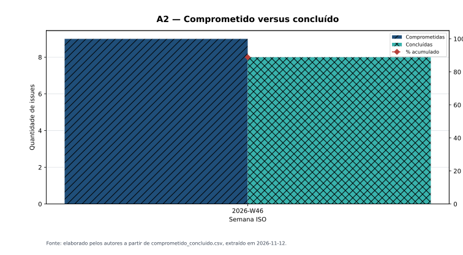
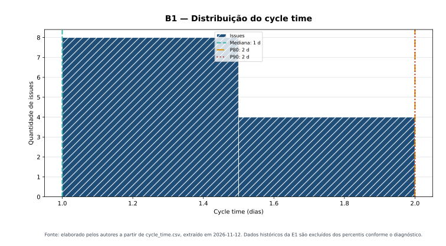
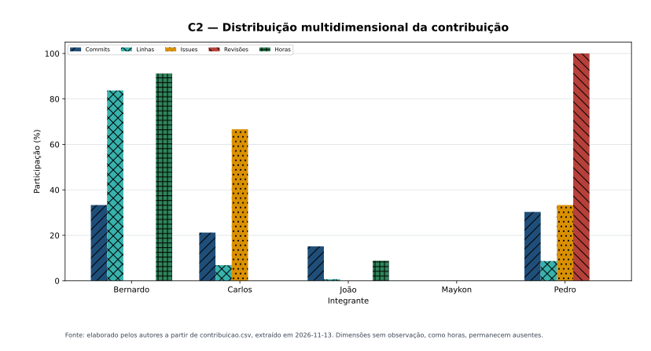

# Texto da gestão PSM/CID para o artigo

Este texto é a versão enxuta transposta para `artigo/main.tex`. Os valores têm data de corte em 11/11/2026 e são rastreáveis aos CSVs consolidados.

## Metodologia de gestão com PSM/CID

A gestão foi instrumentada pelo PSM, abordagem dirigida por necessidades de informação, e pelo *Continuous Iterative Development Measurement Framework* (PSM CID) v2.1. A terminologia de desenvolvimento foi adaptada ao projeto de avaliação: fase da ISO/IEC 25040 equivale a *capability/epic*; produto de trabalho, a *feature*; issue, a *story*; semana ISO, a iteração; e marco da disciplina, a *release*. Uma issue só é concluída quando seu produto está versionado, o critério de pronto foi atendido e, quando aplicável, o pull request foi aprovado por outro integrante.

Os dados são extraídos do Git, GitHub Issues, milestones, pull requests e Project Board, além do apontamento manual de horas. Scripts versionados preservam dados brutos, geram os consolidados e produzem os indicadores. Limiares foram declarados antes da análise da E2; ultrapassá-los exige investigar a causa e registrar uma decisão, não representa automaticamente falha do projeto.

| Categoria | Necessidade de informação | Medidas | Indicador | Critério de decisão |
|---|---|---|---|---|
| Calendário e Progresso | O escopo cabe no prazo e flui sem gargalos? | A1 burndown; A2 comprometido × concluído; A3 fluxo cumulativo | Linhas, colunas e áreas por estado | Desvio A1 > 5%; diferença A2 > 5%; variação de faixa A3 > 10% |
| Desempenho dos Processos | O tempo e a capacidade são previsíveis? | B1 cycle time; B2 velocidade | Histograma e média móvel | Mediana B1 > 5 dias; variação B2 > 10% ou projeção além do prazo |
| Recursos e Custos | O esforço está equilibrado e as estimativas são confiáveis? | C1 esforço; C2 contribuição; C3 estimado × real | Barras e dispersão | Desvio C1 > ±30%; divergência C2 > 30 p.p.; acurácia C3 fora de 0,85–1,25 |

Fonte: elaborado pelos autores a partir do PSM CID v2.1.

## Resultados

Na semana 2026-W46, oito das nove issues comprometidas estavam concluídas: 88,89%, diferença de 11,11%, fora do limiar de A2. O cycle time da E2 apresentou mediana de 1 dia e P80/P90 de 2 dias, dentro do limite de B1, mas a amostra é curta e inclui tarefas criadas perto da conclusão. Em C2, as dimensões apontam papéis diferentes: Carlos concentra issues concluídas; Pedro, revisões e integração; Bernardo e João, as horas reconstruídas. A maior divergência individual é 100 p.p., portanto requer explicação em vez de ser ocultada.

Fonte: elaborado pelos autores a partir de `comprometido_concluido.csv`, extraído em 11/11/2026.

Fonte: elaborado pelos autores a partir de `cycle_time.csv`, extraído em 11/11/2026.

Fonte: elaborado pelos autores a partir de `contribuicao.csv`, extraído em 11/11/2026.

| Decisão | Evidência que disparou | Ação | Efeito observado |
|---|---|---|---|
| DG-02 — registrar horas no dia | Duas semanas com 0 h | Apontamento por sessão e validação automática | A verificar em 17/11 |
| DG-04 — planejar a E2 | Velocidade zero nas W44–W45 | Issues #15–#32 divididas em blocos | 25 pontos concluídos na W46 |
| DG-05 — revisão por pares | E1 sem PR ou revisão registrada | Toda mudança por PR aprovado por outro integrante | Revisões registradas e não conformidade contida |
| DG-08 — congelamento interno | 100% das linhas da E1 nas 48 h finais | Congelar conteúdo três dias antes do marco | A verificar na E2 |

## Ameaças à validade

As horas da E1 e os primeiros registros da E2 foram reconstruídos após o trabalho e têm erro de memória; mesmo os registros contemporâneos sofrem viés de autoapontamento. Commits e linhas alteradas medem integração e tamanho da mudança, não esforço intelectual, por isso C2 mantém cinco dimensões separadas. As poucas semanas instrumentadas e a abertura tardia das issues reduzem a validade de tendências de velocidade e cycle time. Os resultados descrevem este projeto e não devem ser generalizados como produtividade individual.

## Apêndice — Tabela de Contribuição C2

O índice C2 é a média das cinco participações disponíveis — commits, linhas, issues, revisões e horas — e totaliza 100%. Ele descreve a distribuição observável, não uma nota individual.

| Integrante | Commits | Linhas | Issues | Revisões | Horas | Índice C2 |
|---|---:|---:|---:|---:|---:|---:|
| Bernardo Broetto Brun | 0,00% | 0,00% | 0,00% | 0,00% | 91,18% | 18,23% |
| Carlos Eduardo Deusdara Motta | 31,82% | 42,19% | 66,67% | 0,00% | 0,00% | 28,14% |
| João Pedro Sampaio Maciel | 22,73% | 4,31% | 0,00% | 0,00% | 8,82% | 7,17% |
| Maykon Junio dos Santos Soares | 0,00% | 0,00% | 0,00% | 0,00% | 0,00% | 0,00% |
| Pedro Gonçalves Rocha | 45,45% | 53,50% | 33,33% | 100,00% | 0,00% | 46,46% |
| **Total** | **100,00%** | **100,00%** | **100,00%** | **100,00%** | **100,00%** | **100,00%** |

Fonte: `contribuicao.csv`, extraído em 11/11/2026. As horas são reconstruídas e devem ser substituídas pelos registros reais da equipe.
