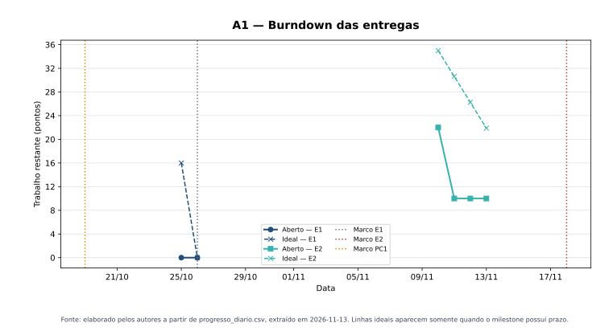
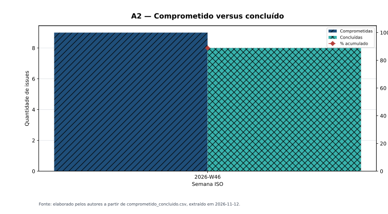
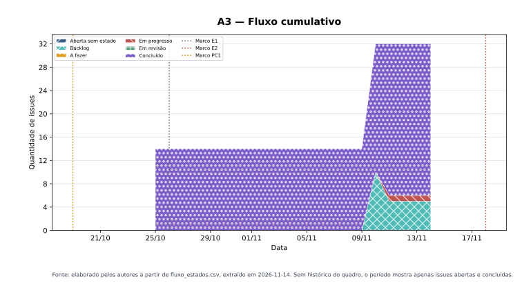
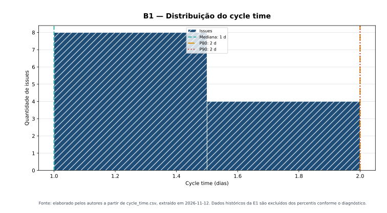
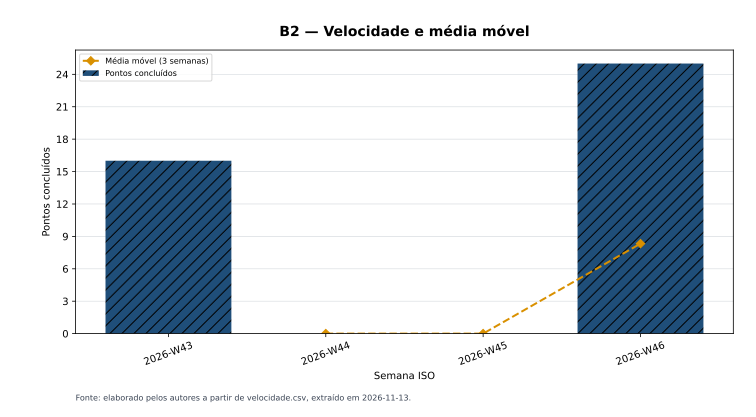
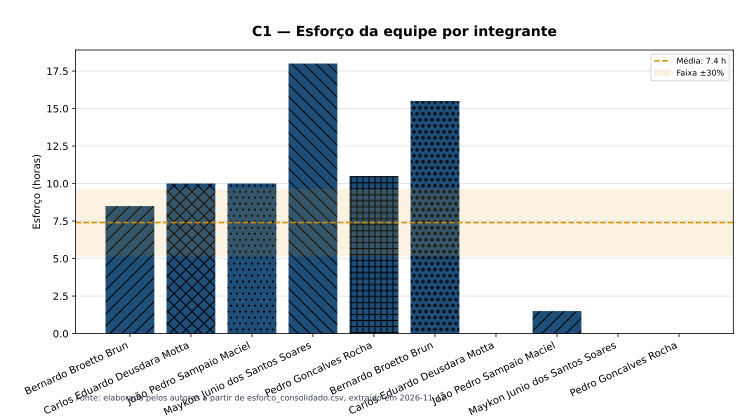
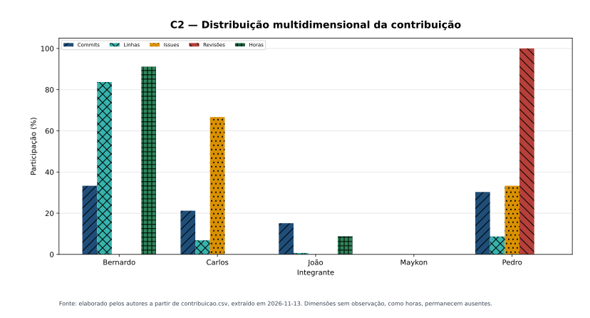
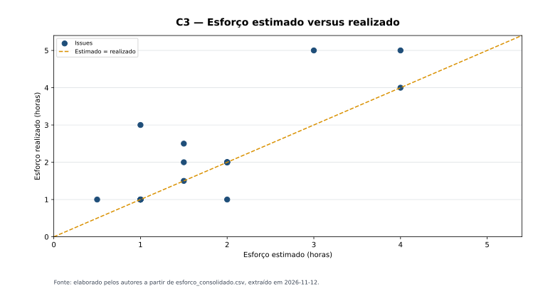

# Dashboard das métricas PSM/CID

> Retrato gerado automaticamente em **13/11/2026** a partir dos dados consolidados. Os valores de esforço dependem do apontamento da equipe e devem ser substituídos pelos registros reais quando disponíveis.

## Tabela-resumo

| Medida | Valor atual | Limiar de decisão | Situação | Última atualização |
|---|---:|---|:---:|:---:|
| A1 — Burndown | 10 pontos abertos; desvio -33,93% | desvio acima da linha ideal ≤ 5% | **Dentro** | 13/11/2026 |
| A2 — Comprometido × concluído | 8/9 issues; diferença 11,11% | diferença ≤ 5% | **Fora** | 13/11/2026 |
| A3 — Fluxo cumulativo | WIP atual: 1 issue | sem crescimento de Em Revisão por 2 semanas | **Dentro** | 13/11/2026 |
| B1 — Cycle time | mediana: 1 dia | mediana ≤ 5 dias | **Dentro** | 13/11/2026 |
| B2 — Velocidade | projeção: 1,2 semanas; prazo: 1 semana | projeção ≤ semanas até o prazo | **Fora** | 13/11/2026 |
| C1 — Esforço | maior desvio individual: 355,88% | desvio individual entre −30% e +30% | **Fora** | 13/11/2026 |
| C2 — Contribuição | maior divergência: 100 p.p. | divergência ≤ 30 p.p. | **Fora** | 13/11/2026 |
| C3 — Estimado × real | acurácia agregada: 1 | acurácia entre 0,85 e 1,25 | **Dentro** | 13/11/2026 |

<p class="legenda">Tabela 1. Situação das medidas obrigatórias. Fonte: elaborado pelos autores a partir dos CSVs consolidados e dos limiares dos <a href="02-construtos-de-medicao/">construtos de medição</a>.</p>

A situação indica se o valor atual permanece dentro do limiar de decisão. Um resultado fora do limiar demanda análise ou ação de gestão; não significa, isoladamente, falha do projeto.

## Calendário e Progresso

### Figura 1. A1 — Burndown das entregas



<p class="legenda">Figura 1. A1 — Burndown das entregas. Fonte: elaborado pelos autores a partir de <a href="dados/consolidados/progresso_diario.csv">progresso_diario.csv</a>.</p>

### Figura 2. A2 — Comprometido versus concluído



<p class="legenda">Figura 2. A2 — Comprometido versus concluído. Fonte: elaborado pelos autores a partir de <a href="dados/consolidados/comprometido_concluido.csv">comprometido_concluido.csv</a>.</p>

### Figura 3. A3 — Fluxo cumulativo



<p class="legenda">Figura 3. A3 — Fluxo cumulativo. Fonte: elaborado pelos autores a partir de <a href="dados/consolidados/fluxo_estados.csv">fluxo_estados.csv</a>.</p>

## Desempenho dos Processos

### Figura 4. B1 — Distribuição do cycle time



<p class="legenda">Figura 4. B1 — Distribuição do cycle time. Fonte: elaborado pelos autores a partir de <a href="dados/consolidados/cycle_time.csv">cycle_time.csv</a>.</p>

### Figura 5. B2 — Velocidade e média móvel



<p class="legenda">Figura 5. B2 — Velocidade e média móvel. Fonte: elaborado pelos autores a partir de <a href="dados/consolidados/velocidade.csv">velocidade.csv</a>.</p>

## Recursos e Custos

### Figura 6. C1 — Esforço da equipe por integrante



<p class="legenda">Figura 6. C1 — Esforço da equipe por integrante. Fonte: elaborado pelos autores a partir de <a href="dados/consolidados/esforco_consolidado.csv">esforco_consolidado.csv</a>.</p>

### Figura 7. C2 — Distribuição multidimensional da contribuição



<p class="legenda">Figura 7. C2 — Distribuição multidimensional da contribuição. Fonte: elaborado pelos autores a partir de <a href="dados/consolidados/contribuicao.csv">contribuicao.csv</a>.</p>

### Figura 8. C3 — Esforço estimado versus realizado



<p class="legenda">Figura 8. C3 — Esforço estimado versus realizado. Fonte: elaborado pelos autores a partir de <a href="dados/consolidados/esforco_consolidado.csv">esforco_consolidado.csv</a>.</p>

## Dados e scripts

- [Diretório dos dados consolidados](dados/consolidados/README.md)
- [Diretório dos dados brutos](dados/brutos/README.md)
- [`consolidar_metricas.py`](https://github.com/FCTE-Qualidade-de-Software-1/2026-2_T01_MARLYN_WESCOFF/blob/main/scripts/consolidar_metricas.py) — gera os CSVs consolidados
- [`gerar_graficos.py`](https://github.com/FCTE-Qualidade-de-Software-1/2026-2_T01_MARLYN_WESCOFF/blob/main/scripts/gerar_graficos.py) — gera as oito figuras
- [`gerar_dashboard.py`](https://github.com/FCTE-Qualidade-de-Software-1/2026-2_T01_MARLYN_WESCOFF/blob/main/scripts/gerar_dashboard.py) — gera esta página e a tabela-resumo
- [`validar_dados.py`](https://github.com/FCTE-Qualidade-de-Software-1/2026-2_T01_MARLYN_WESCOFF/blob/main/scripts/validar_dados.py) — verifica a consistência dos dados

## Como atualizar

```bash
python scripts/consolidar_metricas.py --data-ref AAAA-MM-DD
python scripts/gerar_graficos.py --data-ref AAAA-MM-DD
python scripts/gerar_dashboard.py
python scripts/validar_dados.py
```
